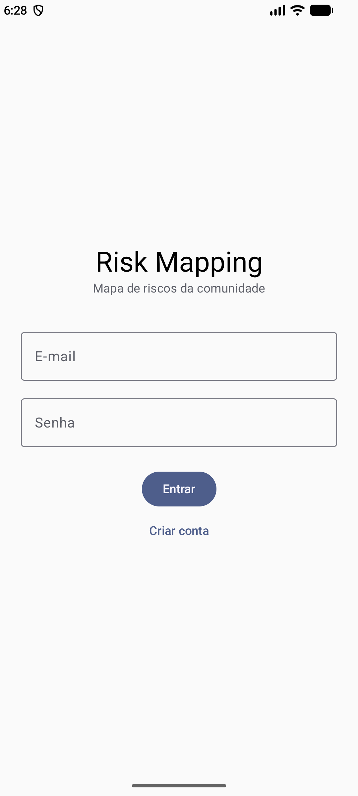
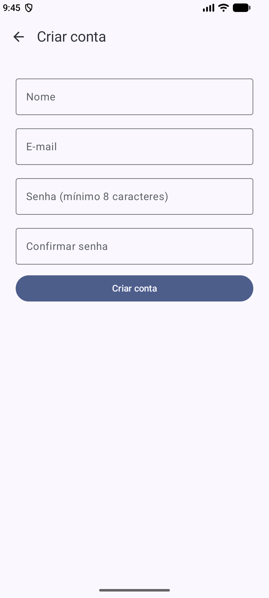
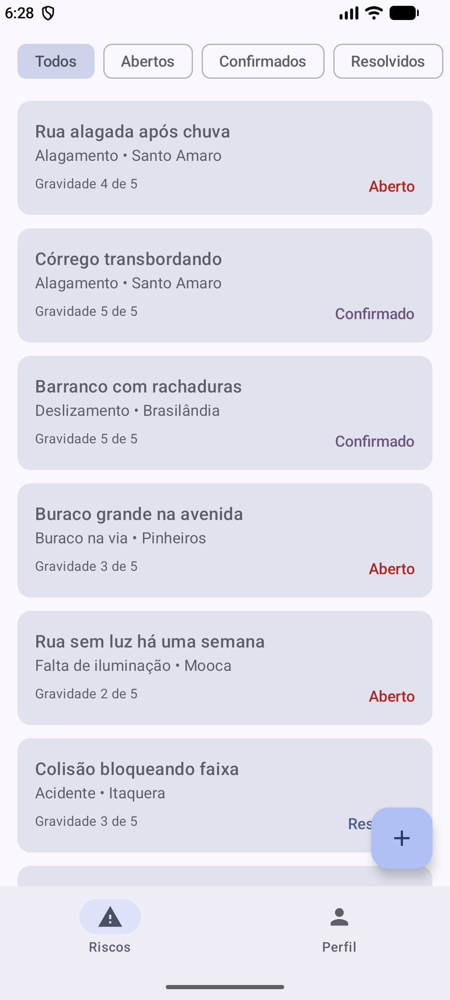
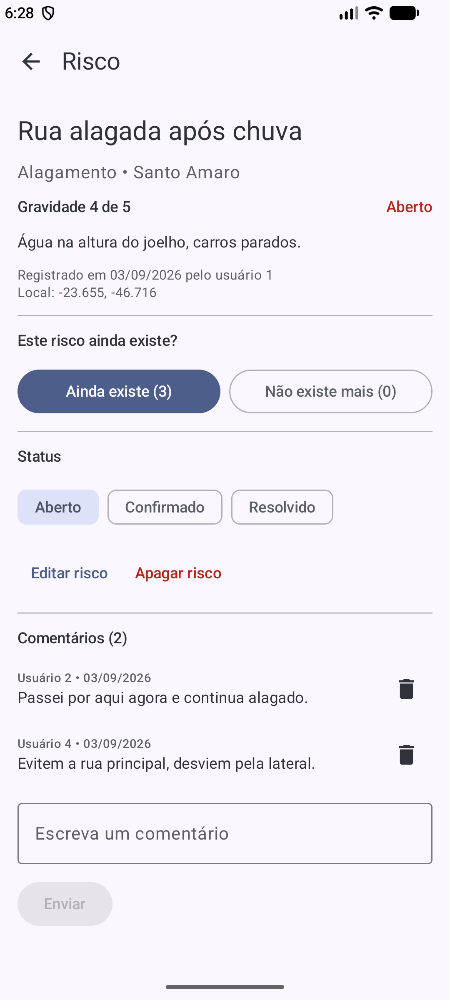
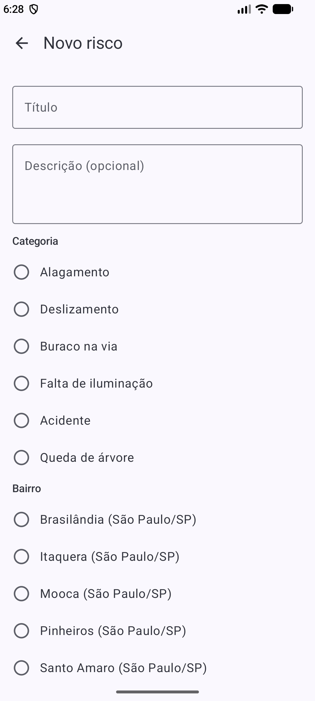
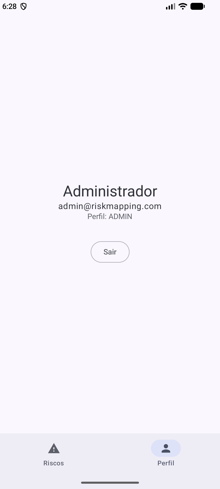

# Risk Mapping (Android)

App Android do **Risk Mapping**, o mapa de riscos da comunidade. Moradores registram problemas do bairro
(alagamentos, buracos, falta de iluminação...), confirmam se o risco ainda existe e comentam nos relatos.

O app consome a API REST do projeto: https://risk-mapping-api.onrender.com
(Swagger: https://risk-mapping-api.onrender.com/swagger-ui/index.html)

## Telas

| Login | Criar conta | Lista de riscos |
|:---:|:---:|:---:|
|  |  |  |
| Entrar na conta | Nome, e-mail, senha e confirmação da senha | Filtro por status e botão **+** para novo risco |

| Detalhe do risco | Novo risco | Perfil |
|:---:|:---:|:---:|
|  |  |  |
| Confirmações, status, comentários, editar e apagar | Título, descrição, categoria e bairro | Dados da conta e botão **Sair** |

A **edição de risco** reaproveita o formulário de novo risco.

## Tecnologias

- Kotlin + Jetpack Compose (Material 3)
- Navigation Compose (rotas por texto, abas dentro da tela principal)
- ViewModel + StateFlow
- Retrofit + Gson para chamar a API
- Login com token JWT (guardado em SharedPreferences); se o token vence (401), o app volta ao login

## Estrutura

```
app/src/main/java/com/example/riskmapping/
├── data/            # API (Retrofit), sessão (token) e catálogo (categorias e bairros)
└── ui/
    ├── login/       # tela de login
    ├── cadastro/    # criar conta
    ├── principal/   # abas: riscos e perfil
    ├── riscos/      # lista, detalhe, novo e edição de risco
    └── componentes/ # peças reutilizáveis
```

## Como rodar

1. Abra a pasta no Android Studio e aguarde o Gradle sincronizar.
2. Rode em um emulador ou celular (Android 7.0 / API 24 ou superior).

A API roda no plano gratuito do Render, que "dorme" sem uso: o **primeiro acesso pode levar cerca de 1 minuto**.
